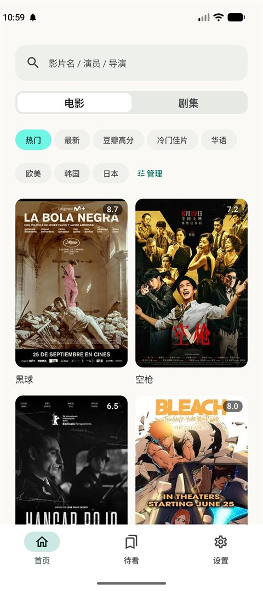
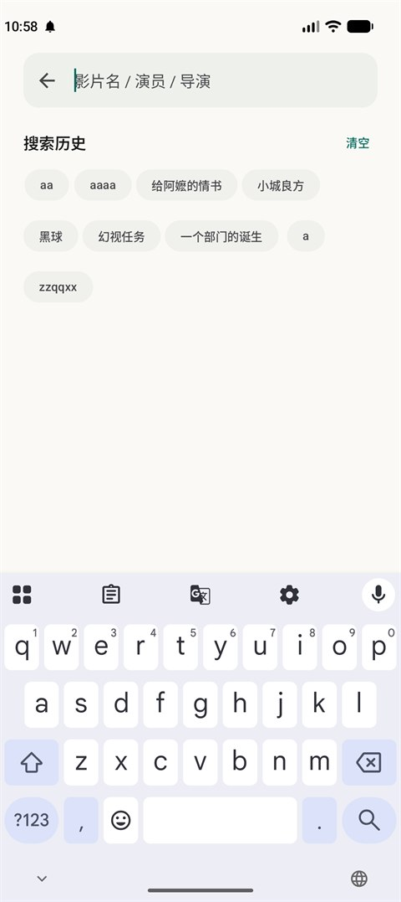
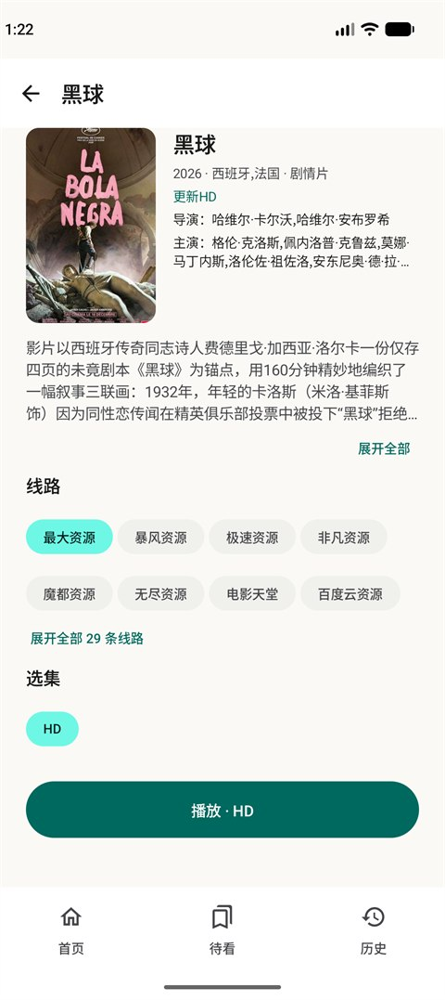
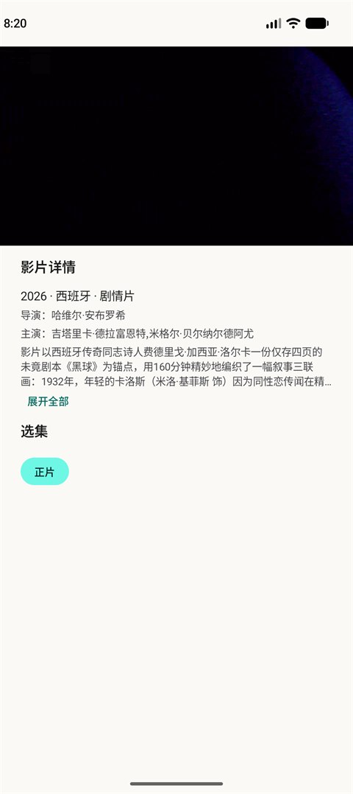
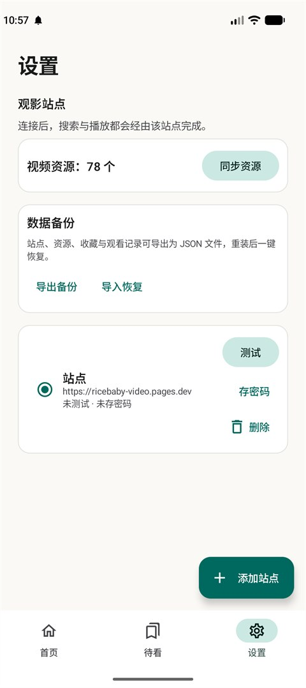

# 海里影视 · Android

[Ricebaby_Video](https://github.com/18haventgirl/Ricebaby_Video) 的安卓客户端，原生界面与原生播放器，后端复用已部署的站点实例。

## 功能

**观影**
- 多源聚合搜索，结果流式返回，可按来源与类型筛选
- 首页标签流推荐，电影 / 剧集分区，标签可隐藏也可自行添加
- 线路与选集即时切换，线路失败或卡顿自动顺延
- 倍速、快退快进、全屏横屏、小窗播放
- 播放中左右滑动调进度，左半屏上下滑动调亮度、右半屏调音量，均有即时反馈
- 观看进度自动记录，下次打开直接续播

**待看**
- 收藏与观看记录保存在设备本地
- 支持一键导出与恢复备份

**站点**
- 多站点实例切换，支持站点访问密码

## 界面预览

截图取自 Pixel_9（Android 16）实机运行，浅色主题。

| 首页 | 搜索 |
| :---: | :---: |
|  |  |
| 详情 | 播放 |
|  |  |
| 待看 | 设置 |
|  |  |


## 下载

到 [Releases](../../releases) 下载最新的 APK，安装即可。签名固定，后续版本可直接覆盖升级。

首次使用：设置 → 添加观影站点 → 同步资源，之后回到首页搜索或浏览推荐。

## 开发

要求 Android Studio 2026.1.3+、JDK 21+、Android SDK 37。

```bash
JAVA_HOME=<JDK 路径> ./gradlew :app:assembleDebug
```

`main` 为稳定分支，`dev` 为集成分支，功能以 `feature/<里程碑>` 开发后合入并打 tag。仓库只存源码，签名密钥与构建产物不入库。

## 说明

- 本项目不含服务端代码，数据采集与代理由站点实例提供
- 收藏与观看记录仅保存在设备本地，多设备之间不同步
- 暂未实现：弹幕、跳过片头片尾
